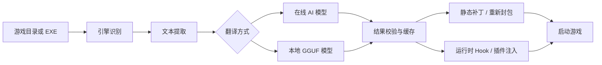

# EngAixt
**AI 游戏翻译与运行时兼容工具**
识别引擎 · 提取文本 · AI 翻译 · 写回游戏

**EngAixt 并非屏幕 OCR 工具。** 译文会直接写入或注入游戏原生的对话框、菜单与道具说明中，最大程度保留原有排版、控制符与变量占位符。

## 核心特性
- **引擎自动识别**：自动检测常见游戏引擎与资源封包类型，匹配对应的处理管线。
- **格式与控制符保护**：批量提取、翻译并回写文本，尽量保留角色名、控制符、占位符、换行和原有格式。
- **可靠批处理工作流**：支持并发翻译、失败重试、翻译缓存、断点续传与译文校验。
- **双模式部署**：根据引擎特性生成静态汉化补丁（重新封包），或部署运行时动态翻译插件。
- **安全可逆与诊断**：提供完整运行日志、脱敏诊断报告，支持一键卸载 EngAixt 生成的文件并还原游戏原始状态。
> **定位说明**：EngAixt 是翻译工作流与引擎兼容层，而非万能解包器。受不同游戏的引擎版本、资源格式及加密保护方式影响，实际支持程度会有所差异。
## 支持的引擎

| 游戏引擎 | 主要处理方式 |
| :--- | :--- |
| **RPG Maker** (XP / VX / VX Ace / MV / MZ) | 静态提取与回写 |
| **Unity** | 运行时注入；部分资源支持静态处理 |
| **Ren'Py** | 静态提取与回写 |
| **BGI / Ethornell** | 静态提取与回写 |
| **KiriKiri / 吉里吉里** | 运行时 Hook；实验性静态 XP3 回写 |
| **Wolf RPG / Wolf RPG Pro** | 静态提取与回写 |
| **Godot** | 静态处理；部分加密资源使用运行时方案 |
| **GameMaker** | 运行时翻译 |
| **Unreal Engine** | 静态文本资源处理 |
| **TyranoScript / TyranoBuilder** | 静态提取与回写 |

- **成熟度说明**：RPG Maker、Unity 和 Ren'Py 的覆盖相对稳定；KiriKiri、Wolf、BGI 和 Godot 仍在持续扩大覆盖范围；Unreal 和 GameMaker 目前仅覆盖部分游戏。
- **KiriKiri 特别说明**：默认使用运行时 Hook；静态 XP3 补丁仍属实验性功能，需手动启用。
## AI 翻译模型
### 1. 在线模型
支持接入以下模型平台：
- DeepSeek
- 通义千问 (Qwen)
- 智谱 GLM
- Moonshot / Kimi
- 豆包 / 火山方舟
- OpenAI GPT
- Anthropic Claude
*注：在线翻译需用户自行配置对应平台的 API Key。所有翻译请求均由客户端直接发送至所选模型服务商，不经过 EngAixt 服务器中转。*
### 2. 本地模型（完全离线）
基于 `llama.cpp` 运行，支持完全离线翻译：

| 模型名称 | 量化版本 | 说明 |
| :--- | :--- | :--- |
| **Hy-MT2 1.8B** | `Q4_K_M` | 资源占用较低，适合实时翻译 |
| **Hy-MT2 7B** | `Q4_K_M` / `Q8_0` | 译文质量更高，需要更多显存 |
| **EngAixt-7B** | `Q4_K_M` | 针对游戏翻译微调，控制符保留能力更强 |

- **模型获取**：`EngAixt-7B` 模型可从 [ModelScope](https://www.modelscope.cn/models/ENGAOXT/EngAixt-7B-GGUF) 下载。
- **功能说明**：目前暂不支持加载任意自定义 `.gguf` 文件。
## 快速开始
1. **下载运行**：Windows 10 / 11 (x64) 用户可直接下载 [官方发布包](https://github.com/kbq1790595929-code/engaixt/releases)，解压后运行 `EngAixt.exe`，无需安装 Python 或配置开发环境。
2. **外部组件**：部分引擎依赖 `GARbro`、`BepInEx`、`Frida` 等外部组件，官方发布包已按支持范围内置所需运行文件（源码仓库不包含全部外部工具二进制文件）。
3. **问题反馈**：遇到兼容性问题时，请先在软件中生成**诊断报告**（会自动过滤 API Key 等敏感配置），并附上相关日志进行反馈。
*本项目完全免费，不提供游戏本体，也不中转任何翻译请求。*
## 开源工具与致谢
本项目使用或集成了以下开源项目：
- **KiriKiri / XP3 资源处理**：`GARbro`、`KirikiriTools`、`msg_tool`
- **RPG Maker 资源处理**：`RPGMakerDecrypter`、`rpgmad`
- **Wolf RPG 资源处理**：`UberWolf`
- **Unity 资源处理**：`UnityPy`、`AssetRipper`
- **Godot 资源处理**：`GDRE Tools`、`GDSDECOMP`
- **Ren'Py 资源处理**：`unrpa`、`unrpyc`
- **Unreal 资源处理**：`UnrealPak`、`FModel`
- **运行时注入与翻译**：`Frida`、`BepInEx`、`XUnity.AutoTranslator`
部分引擎适配器、文本处理逻辑和原生运行时代码由 EngAixt 自行实现。完整许可信息详见 [`THIRD_PARTY_NOTICES.md`](THIRD_PARTY_NOTICES.md)。
## 使用边界
EngAixt 仅面向用户本机已安装的**离线单机游戏**，不用于：
- 联网游戏、竞技游戏或包含反作弊系统的游戏
- 绕过反作弊、账号验证、授权、DRM 或付费校验
- 提供密钥、破解工具或解密后的受保护资源
- 分发游戏原始资源或修改后的游戏内容
## 许可证
本项目采用 GPLv3 许可证开源，详见 [`LICENSE`](LICENSE)。
